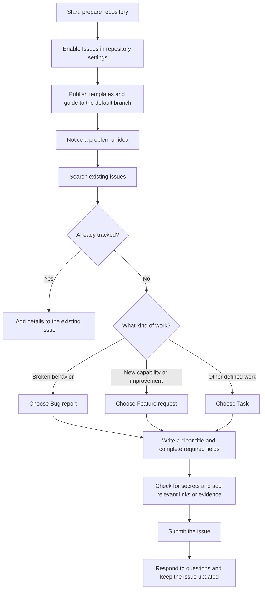

# Writing issues

Before using the forms, make sure **Issues** is enabled in the repository's **Settings > General > Features** and publish the `.github/ISSUE_TEMPLATE/` files and this guide to the default branch.

Use the **New issue** button and choose the form that best matches the work:

- **Bug report** for behavior that is broken or unexpected.
- **Feature request** for a capability or improvement.
- **Task** for a defined piece of work that is neither a bug nor a feature proposal.

Before opening an issue, search existing issues for duplicates. Keep each issue focused on one outcome, use a short descriptive title, and include enough detail for someone else to understand or verify the request. Link related issues and avoid posting secrets or personal information.

For bugs, include reproducible steps and the behavior you expected. For feature requests, explain the problem and the desired outcome. For tasks, state the definition of done. Add logs or screenshots only when they help explain the issue.

